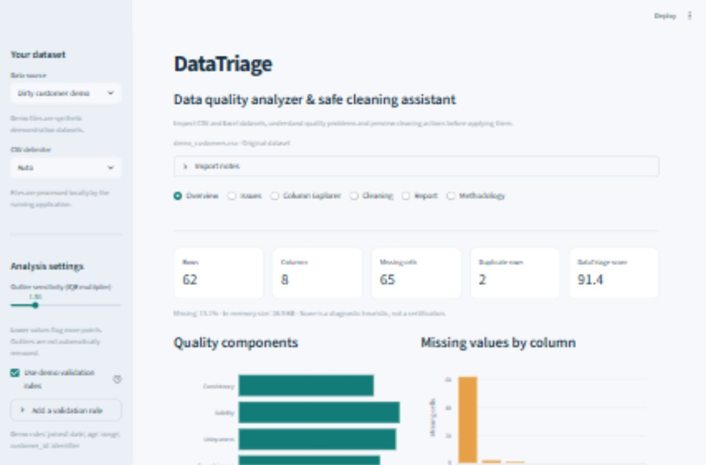
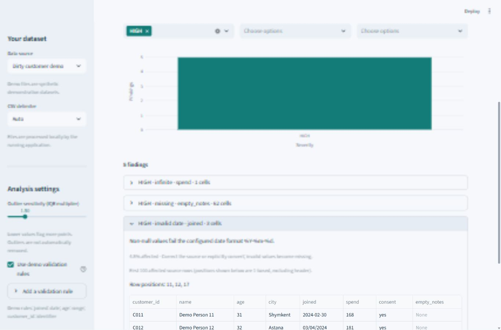
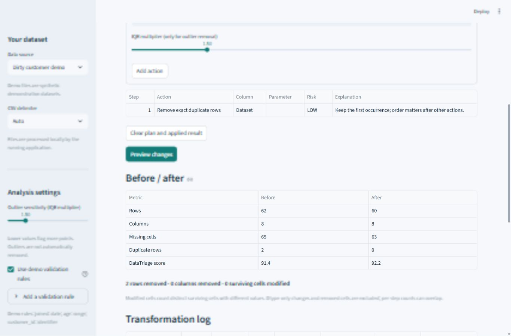

# DataTriage

**Inspect CSV and Excel data, understand quality problems, and preview cleaning before applying it.**

A local Python + Streamlit tool for deterministic data profiling, validation and safe transformation. No AI model, API key, database or cloud service required.

## Why DataTriage?

CSV and Excel datasets often contain missing values, duplicates, malformed dates
and inconsistent formatting. Finding and fixing these manually is slow and easy
to get wrong. DataTriage shows explainable findings, lets you assemble an ordered
cleaning plan, and compares the result with an untouched source before export.

## Features

- Profile CSV or an Excel sheet; inspect missing values, duplicates, types and outliers.
- Add explicit date, numeric, identifier and range rules; inspect affected rows.
- Understand four transparent quality-score components and issue severity.
- Preview an ordered cleaning plan, acknowledge it, then apply it to a separate copy.
- Export cleaned CSV/XLSX and a JSON report with before/after statistics and action history.

## Screenshots

Real captures of the running application with synthetic data.







## How It Works

**UPLOAD → ANALYZE → REVIEW → CLEAN → PREVIEW → APPLY → EXPORT**

1. Choose a synthetic demo or upload a file.
2. Review import notes and add validation rules that reflect your data.
3. Use Issues and Column Explorer to inspect actual affected rows.
4. Add actions in Cleaning. Actions run in the listed order.
5. Preview counts, new missing cells, risks and the resulting table.
6. Acknowledge the preview and apply it to a separate copy.
7. Download the copy and report from Report.

Each plan starts from the original input. Changing the file, sheet, analysis
settings or plan invalidates the old preview/applied output. Nothing is silently
cleaned on import. Exact duplicate/blank headers receive unique names with
explicit import notes so every column remains addressable.

## Quality Score

The **DataTriage quality score** is a diagnostic heuristic, not an industry standard.

Let N be the row count and C the total cell count:

| Component | Formula |
| --- | --- |
| Completeness | 100 × (1 − missing cells / C) |
| Uniqueness | 100 × (1 − duplicate rows after the first / N) |
| Validity | 100 × (1 − distinct invalid cells / C) |
| Consistency | 100 × (1 − distinct inconsistent cells / C) |

Overall is the equal-weight mean of the four unrounded components, rounded to
two decimals. Values are bounded 0–100. A dataset without cells has **no score**.

Validity includes infinity and explicit numeric/date/range rule failures.
Consistency includes whitespace, blank text, case/whitespace category variants,
mixed stored Python types, mixed numeric/text values and mixed date shapes.
Within each component, overlapping flags on a cell count only once.
Outliers, constants, duplicate headers/columns and identifier violations remain
visible issues but do not directly lower this score. With no configured domain
rules, validity checks only infinity: a high score is not proof of correctness.

Severity is rule-based: HIGH for configured failures, infinity and at least 20%
missing in a column; MEDIUM for duplicate rows/headers, empty/almost-empty columns
(95% by default) and mixed types; LOW for other missing values, whitespace and
format/category variants; INFO for outliers, constants and structural hints.

## Quick Start

Requires Python 3.11 or newer within the supported dependency ranges.
Python 3.12 is the locally validated runtime; CI is configured for 3.11 and 3.13.

Clone the repository, or open the downloaded project folder:

```powershell
git clone https://github.com/arysbey/DataTriage.git
cd DataTriage
python -m venv .venv
.\.venv\Scripts\python.exe -m pip install -r requirements.txt
.\.venv\Scripts\python.exe -m streamlit run app.py --server.port=8502
```

Open **http://127.0.0.1:8502**. The configured server binds to loopback.

On Windows, after installing dependencies, double-click **Start_DataTriage.bat**.
It runs the existing virtual environment on port 8502 and never installs packages.
A missing environment produces setup instructions. Keep the launcher running;
close its terminal or press Ctrl+C to stop the app.

macOS / Linux:

```bash
python3 -m venv .venv
source .venv/bin/activate
python -m pip install -r requirements.txt
python -m streamlit run app.py --server.port=8502
```

## Demo Data

Everything under `demo_data/` is **synthetic demonstration data**.

- `demo_customers.csv`: 62 rows, including 2 exact duplicates, missing values,
  whitespace/case variants, invalid dates, a negative age, infinity and an outlier.
- `demo_inventory.csv`: 20 clean rows.
- `demo_workbook.xlsx`: Customers and Inventory sheets.

The customer demo offers visible rules for ISO joined dates, age 0–120 and unique
customer IDs. These assumptions are specific to that demo and are not applied to
arbitrary uploads. Regenerate fixtures with `python scripts/generate_demos.py`.

## Architecture

```text
app.py                    Streamlit composition and session state
datatriage/
  models.py               Typed settings, issues, actions and results
  validation.py           Resource limits and rule validation
  loading.py              Bounded CSV/XLSX parsing and import notes
  profiling.py            Overview, column statistics and IQR masks
  detectors.py            Independent deterministic issue engine
  scoring.py              Explainable score with cell-level deduplication
  cleaning.py             Ordered transformations on a deep copy
  reporting.py            Strict JSON and spreadsheet exports
  ui.py                   Reusable views
tests/                    Business-logic and Streamlit AppTest checks
demo_data/                Synthetic CSV and workbook fixtures
scripts/generate_demos.py  Reproducible demo source
assets/                   Actual browser screenshots
```

CSV values remain text, preserving leading zeros and literal strings such as
`NA`. Empty fields become missing; whitespace-only text is flagged separately.
Numeric type suggestions do not change the source. XLSX native scalar types are
retained; formulas are loaded as literal strings and never evaluated.

## Testing

```powershell
.\.venv\Scripts\python.exe -m pytest -q -W error
```

Tests cover loading failures/limits, statistics, detector counts and positions,
score arithmetic, transformation ordering and copy invariants, invalid plans,
report serialization, formula-safe export, and UI state transitions.

See [validation record](docs/validation.md) for actual results, browser scenarios
and measured limits. The workflow runs pytest on push and pull request with
[checkout](https://github.com/actions/checkout) and
[setup-python](https://github.com/actions/setup-python).
See the [Actions page](https://github.com/arysbey/DataTriage/actions) for verified
workflow results for each commit.

## Privacy

**Files are processed locally by the running application.**

No external APIs, analytics integrations, login or database. Streamlit usage
statistics are disabled. Uploaded datasets stay in session/process memory;
the application does not save uploads to disk. Downloading creates a file in
your browser's download location. Reports contain column names, row positions
and action parameters, including custom replacement text, but not source rows.

If hosted on another computer, processing happens there. This is not encrypted
storage, a hardened upload service, a secure-erasure guarantee or a certification.

## Assumptions & Limitations

- No automatic understanding of business meaning. A missing cell, duplicate or
  outlier may be legitimate. Human judgment is necessary.
- Dates need an explicit format to validate/convert. Date shapes alone do not prove
  a column contains dates. Mixed date formats are not automatically reconciled.
- IQR uses finite values and at least 4 observations; default fences are
  Q1 − 1.5 × IQR and Q3 + 1.5 × IQR. IQR = Q3 − Q1. Zero IQR can flag any
  value differing from the quartiles.
- Numeric conversion uses floating-point values; precision-sensitive identifiers
  and monetary calculations require special care. Invalid conversions become
  missing and are counted in the preview.
- Filling from mean/median uses finite values; an all-missing column cannot invent
  a statistic. Mode ties use the value encountered first.
- Modified-cell totals count distinct surviving cells whose values differ from the
  source, not dtype-only changes or removed cells. Per-step counts can overlap.
- Limits: 10 MB input, 50,000 rows, 200 columns, 2 million cells, 50 MB expanded XLSX.
  Core metrics use all cells; charts sample at most 5,000 numeric values with a fixed seed.
- Excel formatting, macros, merged-cell structure and workbook layouts are not
  preserved. The selected sheet becomes a single cleaned output sheet.
- XLSX strings are written literally, including formula-shaped text. Integers over
  15 digits are exported as text; other numbers remain subject to Excel precision.
  Unsupported control characters and text over 32,767 characters are rejected
  with a CSV alternative.
- The dedicated CSV export defaults to prefixing formula-shaped strings/headers
  with an apostrophe. This is a disclosed export-only change and can be disabled
  for exact text export. Table-toolbar exports are previews, not this protected export.
- Reports include only the first 100 row positions per finding; total counts remain exact.
- Large-scale/distributed data processing and automatic semantic validation are out of scope.

## Future Improvements

Persistable, versioned rule/plan presets; per-value corrections; explicit decimal
and locale parsing; broader date-format support; streaming processing for larger data.
These are ideas, not implemented capabilities.

## License

[MIT](LICENSE). For a Russian walkthrough and hackathon explanations, see
[PROJECT_EXPLAINED.md](PROJECT_EXPLAINED.md).
